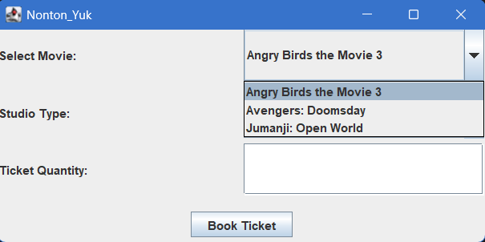
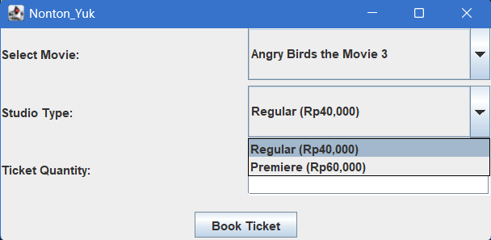
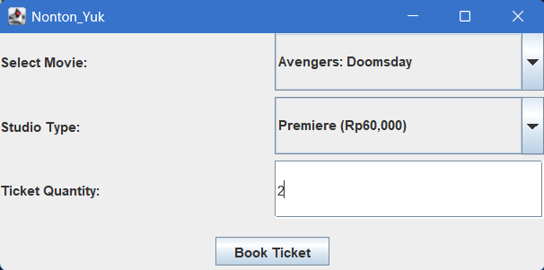
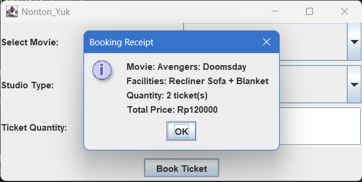

# Graphical User Interface

An Object-Oriented Programming (OOP) assignment implementing basic Graphical User Interface (GUI) components using Java Swing for a cinema ticket booking simulation.

## Class Structure
- `NontonYuk.java`
  - The main file containing the `main` method to build the application window (`Nonton_Yuk`), arrange input components and buttons using several layouts, and handle price calculation and booking receipt display when the button is clicked.

## Implementation of 5 GUI Components
- **Top Level Container Class**
  - Uses `JFrame` as the main application window with the title `"Nonton_Yuk"`.
  - Configures the window size via `setSize(500, 250)`, centers it on the screen with `setLocationRelativeTo(null)`, and sets the exit action using `JFrame.EXIT_ON_CLOSE`.
- **Intermediate Container Class**
  - Uses two `JPanel` containers to group components inside the frame: `panelForm` to hold the labels and form inputs, and `panelTombol` specifically to hold the button.
- **Atomic Component Class**
  - `JLabel` to display descriptive text (`Select Movie:`, `Studio Type:`, and `Ticket Quantity:`).
  - `JComboBox` for the movie list (`cbFilm`) and studio type (`cbTipe`) dropdown menus.
  - `JTextField` (`txtJumlah`) to receive the ticket quantity input from the user.
  - `JButton` (`btnPesan`) labeled `"Book Ticket"` to process the booking.
  - `JOptionPane` to display the booking receipt pop-up (`Booking Receipt`).
- **Layout Classes**
  - `BorderLayout` is applied to the `JFrame` to divide the main layout, placing `panelForm` in the `CENTER` and `panelTombol` in the `SOUTH`.
  - `GridLayout` is applied to `panelForm` (`3` rows, `2` columns) so that the label and input pairs are neatly arranged in a grid.
  - `FlowLayout` is applied to `panelTombol` so that the `"Book Ticket"` button is centered with a proportional size.
- **Event Listener**
  - Implements the `ActionListener` interface on `btnPesan` using an *anonymous inner class*.
  - Overrides the `actionPerformed(ActionEvent e)` method with the `@Override` annotation to retrieve the selected movie, studio type, and ticket quantity, calculate the total price, and display the result via `JOptionPane.showMessageDialog`.

## Output

1. **Select Movie Dropdown**  
   

2. **Studio Type Dropdown**  
   

3. **Filled Booking Form**  
   

4. **Booking Receipt Pop-up**  
   
